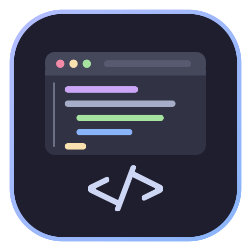
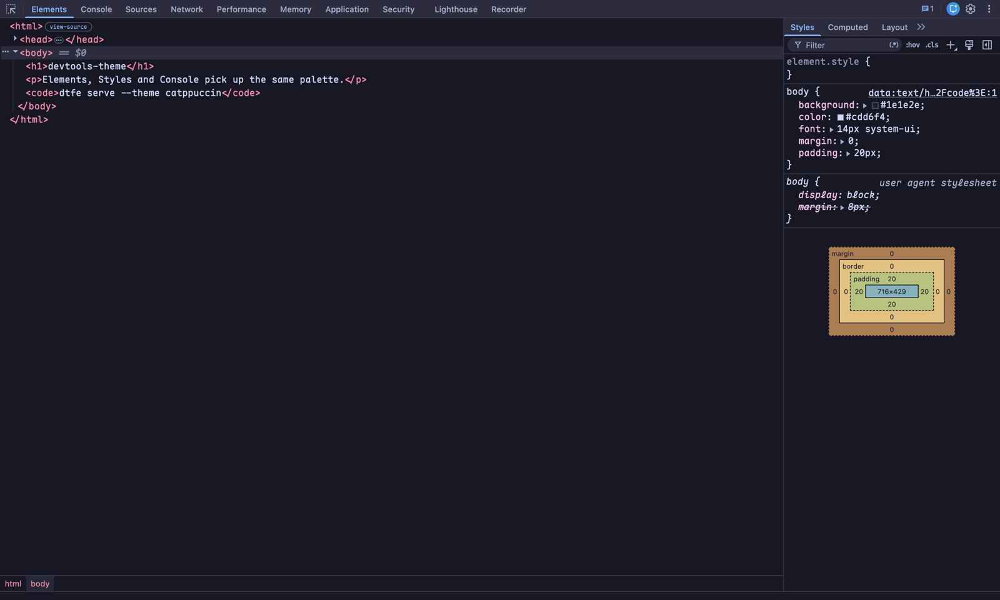
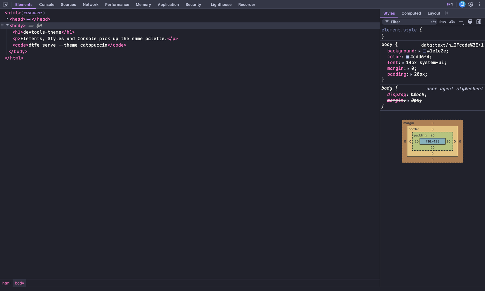
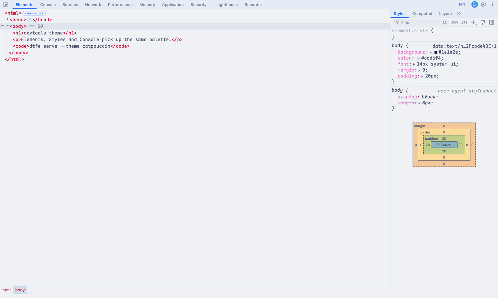

# devtools-theme

Theme Chrome DevTools by building the frontend your browser actually ships — then
recolouring it. Bring your own palette; this is the engine, not a theme.

```
dtfe doctor                     # which Chrome, which frontend commit, what's cached
dtfe build                      # compile that frontend once (~10 min, 3 GB scratch)
dtfe render dracula -o out.css  # just the CSS, no build needed
dtfe serve --theme catppuccin   # serve it, then open DevTools as usual
dtfe launch --theme dracula     # serve + open Chrome with the flag
```



## Why this exists

Chrome used to let extensions restyle DevTools (`chrome.devtools.panels.
applyStyleSheet`, behind the "Allow extensions to load custom stylesheets"
experiment). That experiment was deleted: `apply-custom-stylesheet` is absent
from `front_end/core/root/ExperimentNames.ts`, and neither `applyStyleSheet` nor
`applyCustomStylesheet` appears anywhere in the Chrome 155 binary. Every
"DevTools theme" extension on the Web Store is dead, and Catppuccin's own port
(`catppuccin/chrome-devtools`) was archived for exactly this reason.

What is left is `--custom-devtools-frontend=<url>/`: Chrome proxies every
`devtools://devtools/bundled/*` request to that base URL. So the only way to
change DevTools' appearance is to serve a modified copy of its frontend. Its
frontend is compiled into the browser, so "a copy" means compiling the matching
commit yourself. That is what `dtfe build` does.

## Scope

In scope:

- **version alignment** — detect the installed browser, ask chromiumdash for the
  exact `devtools-frontend` commit it shipped, and keep builds apart per version;
- **build** — fetch that commit, `gclient sync`, `npm ci`, `gn`/`ninja`, prune,
  cache;
- **theme compilation** — ~24 role colours → ~250 tonal ramps → `--sys-color-*`
  plus fonts;
- **serving** — one URL that Chrome can consume;
- **launch** — hand that URL over with `--custom-devtools-frontend`, and say so
  when a running Chrome is going to ignore it.

Deliberately out of scope:

- patching Chrome itself, its profile, or its resources;
- shipping prebuilt frontends (CI may attach them; the engine doesn't need them);
- a theme store or registry;
- OS entry points (Dock items, launchers, menu bar), profile separation, icons for
  second instances;
- "any palette looks good". The maths gets contrast roughly right; `raw` is the
  escape hatch for the one divider that reads wrong.

The invariant that keeps this maintainable: **inject CSS at the outermost layer,
never edit frontend source.** Everything can be regenerated for a new Chrome
version; patching frontend JS would turn this into a fork, with a fork's upkeep.

## The gap: from a URL to your daily browser

`dtfe serve` prints a URL. Turning that into "DevTools is themed whenever I open
it" is a second, thinner layer — and it is not the icon, the icon is only that
layer's surface. Four pieces:

1. **A server that is always up.** If nothing is listening, DevTools does not
   degrade, it fails to open at all. Needs a daemon (launchd/systemd) or
   self-healing on launch.
2. **Launch orchestration.** The switch is per-process, and a Chrome that is
   already running eats it silently (per-profile single-instance lock). So:
   detect, quit gracefully, relaunch with the flag, let session restore bring the
   tabs back.
3. **An entry point.** `dtfe launch`, a Dock item, a shell abbr, a menu bar item.
   Pick one; none of it is technically required.
4. **Instance separation.** If you also keep a debug/automation Chrome, it needs
   its own profile and its own icon, otherwise the Dock hands you two identical
   tiles and you stop being able to tell which is which.

`~/Projects/devtools-catppuccin` is that layer on macOS: a Dock launcher, a
`launch.fish`, `chr`/`chd` abbreviations, and a second Chrome bundle carrying a
`</>` icon. Items 1–2 belong in the engine eventually (`dtfe agent install`, and
quit-then-relaunch inside `dtfe launch`); items 3–4 are per-OS and should stay in
thin wrappers.

## Themes

A theme is ~24 colours per variant. DevTools paints itself from ~150 semantic
`--sys-color-*` tokens built on ~250 tonal ramps (`--ref-palette-<family><tone>`,
Material-style 0–100), so the engine derives the ramps and the theme only says
what the app should *look* like:

```json
{
  "name": "My Theme",
  "fonts": {"mono": "Maple Mono NF CN", "monoSize": 14},
  "variants": {
    "dark": {
      "neutral": {"0": "#11111b", "10": "#1e1e2e", "40": "#585b70", "90": "#cdd6f4", "99": "#e6e9ef"},
      "accents": {"primary": "#89b4fa", "tertiary": "#cba6f7", "error": "#f38ba8",
                  "green": "#a6e3a1", "yellow": "#f9e2af"},
      "surfaces": {"surface": "#1e1e2e", "container": "#181825", "base": "#2c2c3e",
                   "baseContainer": "#181825", "divider": "#3b3c50"},
      "syntax": {"keyword": "#cba6f7", "string": "#a6e3a1", "number": "#fab387"}
    }
  }
}
```

- `neutral` — as few as two tonal anchors; missing tones are interpolated and the
  rest of the ramp is derived. Light variants want the dark end = text and
  tone ~99 = surface (DevTools' light theme reads `on-surface` from tone 10).
- `accents` — one brand colour per family. Tone 40 of the ramp equals the brand
  in light themes, tone 80 in dark, because those are the tones DevTools reads
  `--sys-color-primary` from.
- `surfaces` — the four panel backgrounds plus the divider. Needed because
  `devtools://` always adds `.baseline-default`, whose built-in block would
  otherwise repoint surface/base at its own neutral100/neutral10.
- `syntax` — `--sys-color-token-*`. These inherit nothing useful, so set the ones
  you care about; the rest falls back to sensible families.
- `raw` — escape hatch: any `--sys-color-*` / `--ref-palette-*` you want verbatim.
  Auto-derivation gets contrast roughly right, not perfectly; this is where you
  fix the one divider or comment colour that reads wrong.

Bundled: `catppuccin` (Latte + Mocha) and `dracula` (the light side is an
Alucard-flavoured approximation, hence "experimental").

Catppuccin / Dracula, same engine, same frontend — only the JSON differs:

| | |
| --- | --- |
|  |  |

## Layout

```
bin/dtfe.mjs      CLI
lib/chrome.mjs    which Chrome + which devtools-frontend commit (chromiumdash)
lib/build.mjs     git fetch -> gclient sync -> npm ci -> gn -> ninja -> prune
lib/theme.mjs     theme JSON -> the ~250-tone palette + CSS
lib/serve.mjs     static server with the theme injected per request
themes/*.json     presets
```

## What is verified, what isn't

Verified on Chrome 155.0.8059.85 / macOS: the build pipeline, both bundled
themes, the `devtools://` proxy path (`--custom-devtools-frontend` serving the
build), the monospace font override (platform font resolved as
`MapleMono-NF-CN-Regular` by `CSS.getPlatformFontsForNode`), and the baseline
override.

Not verified: Linux and Windows builds (the pipeline is written for both, nothing
was run there), and the dock/profile wrappers in `docs/` (macOS conveniences, not
part of the engine).

## Requirements

- Chrome/Chromium/Edge, and the version it currently is — the frontend must match
  the browser, mismatches show up as missing host APIs rather than a clean error.
- `dtfe build`: git, node ≥ 18, python3, ninja, Xcode CLT (macOS) or
  build-essential (Linux), ~3 GB free scratch, ~1.5 GB download.
- `dtfe serve`/`render`: node only.

Builds are cached per Chrome version under `~/.cache/devtools-theme/<version>/`
(override with `DEVTOOLS_THEME_CACHE`). After a Chrome update, `dtfe doctor` says
so and `dtfe build` adds the new version; old builds are kept so you can roll
back.

## Notes

- The server re-reads the theme CSS on every request: edit the theme, then close
  and reopen DevTools. No server restart. *Switching* themes still means
  restarting `serve` with another `--theme` — `--theme-file` is the next gap to
  close.
- `--custom-devtools-frontend` is read once at process start. A Chrome that is
  already running ignores it, so `dtfe launch` will tell you to quit first.
- Unsupported territory: this is a local frontend override, not a Chrome feature.
  Nothing here is affiliated with Google; the frontend itself is Chromium code
  under BSD-3 (its licence headers travel with the build).
